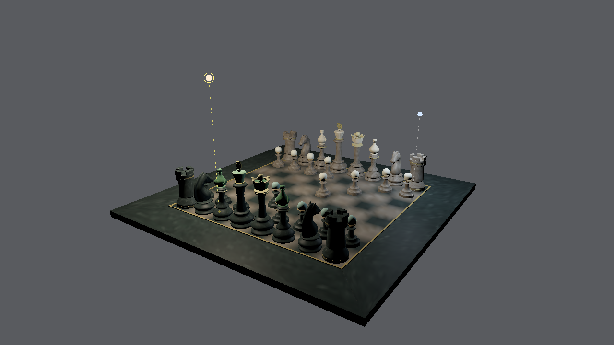

# FkJensen

A 3D viewport that renders on the CPU and nothing else. No GPU API is
linked (no Vulkan, OpenGL, Metal, wgpu): the frame is rasterised on the
cores with rayon and copied to the window through shared memory
(softbuffer).

It does not read USD. Scenes are in FkJensen's own `.fkj` format
(`docs/format.md`), with geometry already cut into the clusters the renderer
draws. The Open Chess Set is baked into the program and opens by default.
The only light type is the point light, and moving lights is the main thing
the viewer is for.

## Build

Rust 1.85 or later (edition 2024). No system libraries are needed to build.

    cargo build --release

Builds on Linux x86-64 and aarch64 (Raspberry Pi), macOS and Windows. The
window backend is winit; on Linux it uses X11 or Wayland, whichever is
running.

## Run

    cargo run --release                     the built-in chess set
    cargo run --release -- scene.fkj        another .fkj scene

Headless, for tests and screenshots (no window, no display needed):

    cargo run --release -- --png out.png --size 1920x1080
    cargo run --release -- --png out.png --light 0.1,0.3,0.2,0.5 --light -0.2,0.15,-0.1

`--light x,y,z[,intensity]` replaces the scene's lights; it can be given
more than once. Positions are in metres.

The window title shows the frame rate, the selected light's position and
intensity, triangle and cluster counts, and the time of each pass in
milliseconds: setup, bin, raster, shade.

## Controls

    Lights (the only light type is a point light)
    left drag on a light   move it, facing the camera (stays at its depth)
      + Ctrl               move it level, over the set (keeps its height)
      + wheel              push it away / pull it closer
    arrows                 nudge the selected light, relative to the view
    Page Up / Page Down    raise / lower the selected light (Shift: 5x)
    1 (hold) + click       add a light above the surface under the cursor
    2 (hold) + click       put the selected light above that surface
    Tab                    select next light     Delete   remove selected light
    + / -                  intensity             C        cycle colour
    L                      show / hide lights    R        reset to the scene's lights

    Camera
    left drag              orbit                 middle drag / shift+left   pan
    right drag             look (fly)            wheel                      dolly
    W A S D Q E            fly (shift: faster)   F                          frame the scene

    View
    [ / ]                  exposure              B    back-face culling
    G                      wireframe             P    save frame.png
    Esc                    quit
    drop an .fkj file on the window to open it

Lights are drawn as discs in their colour; the selected one has a yellow
ring. A disc goes dim when it is behind geometry. A dashed line drops from
each light to the floor of the scene with a dot where it lands, so its
height reads at a glance. Clicking a disc selects the light and starts
dragging it; clicking anywhere else orbits as usual.

There is no ambient light: a surface no light reaches is black. There are
no shadows yet either, so a light lights every surface that faces it.

## How a frame is made

`src/raster.rs`, four passes, all parallel:

1. Setup: each cluster is tested against the view frustum as a whole, and,
   with back-face culling on, against its normal cone. A surviving
   cluster's vertices (64 at most) are projected into a local array and its
   triangles are clipped against the near plane and written as screen-space
   records.
2. Bin: each record is listed in every 64 x 64 tile its box touches.
3. Visibility: each tile is rasterised by one thread into its own depth and
   triangle-id buffer. Depth is 1/w, so it is perspective-correct and
   needs no far plane. No atomics, no locks.
4. Shade: each pixel that has a triangle reconstructs its barycentric
   weights, interpolates position, normal and albedo from the source
   triangle, and is lit once by each point light: Lambert diffuse and a
   small Blinn-Phong highlight, falling off with 1/d², scaled so intensity
   1 at one scene radius gives irradiance 1.

Shading after visibility is what keeps the cost proportional to pixels:
a hidden triangle is never shaded.

`src/scene.rs` holds the scene: positions, normals, albedo and indices in
flat arrays, and the cluster list. `src/fkj.rs` reads and writes `.fkj`.
`src/lights.rs` is the light rig and the picking and dragging maths.

## Measured

On the machine this was written on (2 cores of an Intel Xeon at 2.1 GHz,
no SIMD, 19/10/2026), the built-in chess set (1,430,784 triangles, 21,443
clusters), one 1280 x 720 frame from the default camera, three runs:

| setup | bin | raster | shade | total |
|---|---|---|---|---|
| 134 to 146 ms | 11 to 14 ms | 47 to 52 ms | 20 to 23 ms | 215 to 230 ms |

The previous build drew 799,384 triangles of this set in 144 ms on the same
machine: the pawns from the USD point instancers were missing, and are
there now. From the default camera every cluster is in view, so cluster
culling saves nothing in this measurement. Loading the built-in scene takes
0.05 s.

Not measured yet: a Raspberry Pi.

## Not done yet

- Shadows, reflections, global illumination: every light is unshadowed.
- SIMD: the inner loops are scalar.
- Vertex splatting and cluster level of detail.
- Points, curves and volumes in `.fkj` (tags reserved).
- Materials and textures: albedo per vertex only.
- No converter in the repository: the chess set was baked once and other
  scenes cannot be made from here yet.
- Light rigs are not saved.
- Text overlay: the numbers are in the window title.
- Ctrl-dragging a light when the camera looks along the horizon edge-on
  does nothing until the view tilts.

Credit: FkJensen was created by Simon Legrand. The chess set is CC BY 4.0;
see `assets/README.md`.
