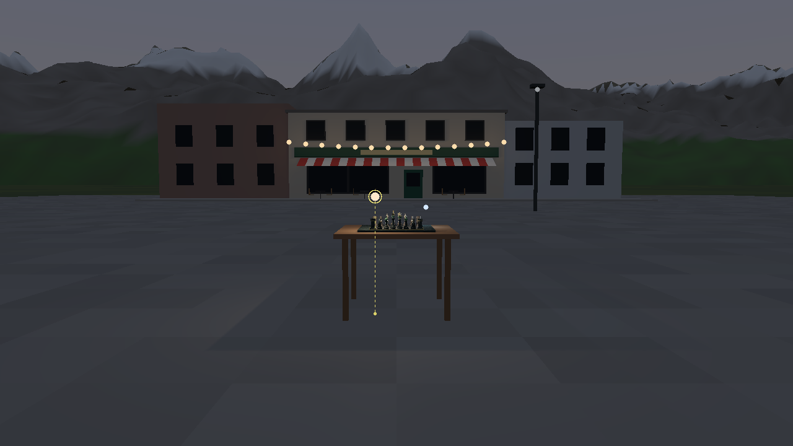
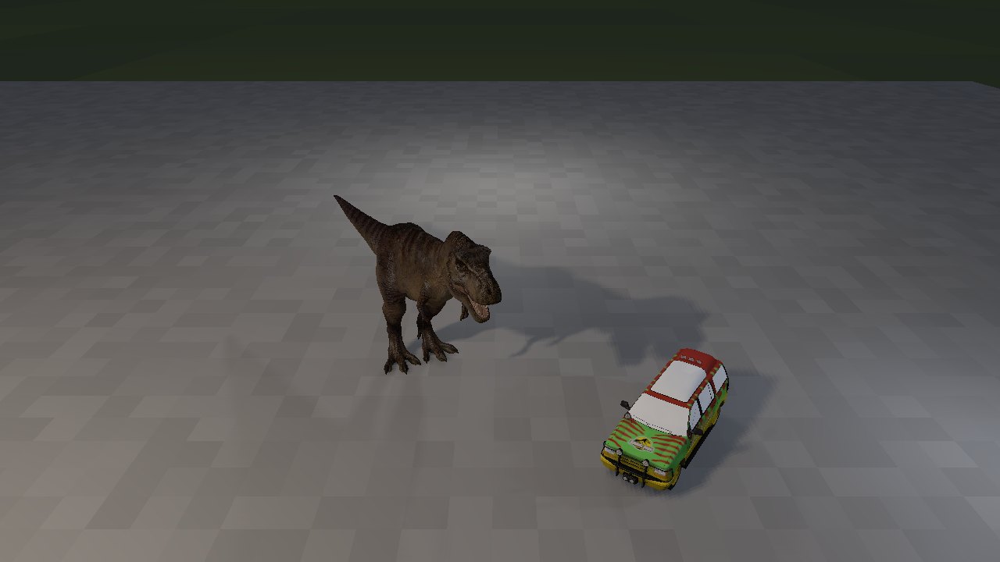
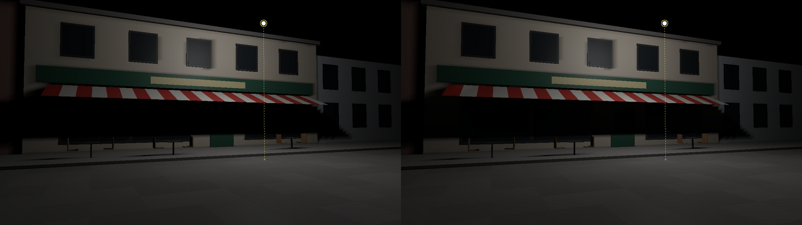
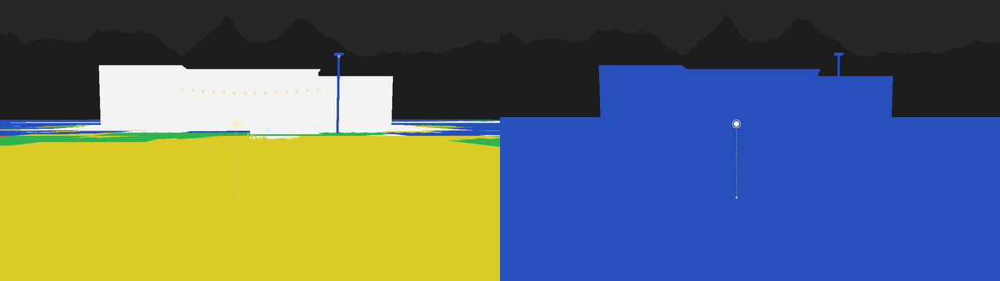
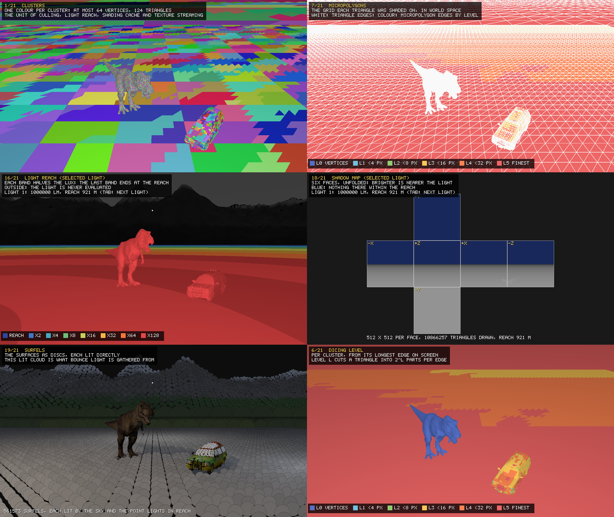
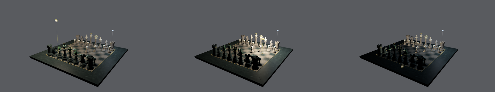
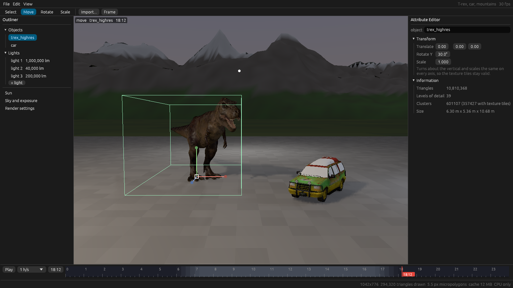
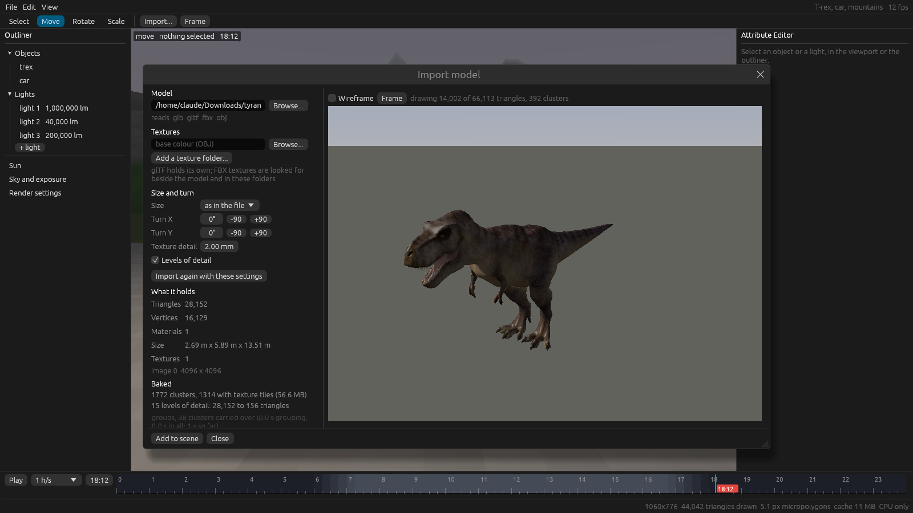

# FkJensen

A 3D viewport that renders on the CPU and nothing else, following the path
3D graphics would have taken if GPUs had never existed (see
`DESIGN_PHILOSOPHY.md`): REYES-style shading kept between frames, shadow
maps, point-based bounce light, no ray tracing. No GPU API is linked; the frame is made on the cores
with rayon and copied to the window through shared memory (softbuffer).

It does not read USD. A scene is an `.fjs` file, a small JSON file
(`docs/scene.md`) that points at `.fja` assets and says where each stands,
the lights, the sun, the sky, the camera and the render settings. An
`.fja` is one object with everything baked for it (`docs/format.md`):
geometry already cut into the clusters the renderer draws, levels of
detail, texture tiles, surface samples and their sky transfer. Old `.fkj`
scenes, which held everything in one file, still open, and save as an
`.fjs` and `.fja` files.

The built-in set, all real geometry, in metres:

- a T-rex (10.8 M triangles, a ZBrush sculpt, with its texture baked to
  vertex colours and tiles) and a car (17 K triangles), on a 100 m paved
  ground plane;
- far background: mountains 4 to 12 km away, up to about 2 km high.

The ground (the square and the valley floor) and the mountains are objects
like any other, `ground` and `mountains` in the outliner: they move, take
materials and can be deleted. A scene file names them as the assets
`built-in:ground` and `built-in:mountains`; for bounce light they are
open ground, and they get no surface samples.

On machines whose plan leaves it out (see Fitting the machine), the T-rex is
its 28 K-triangle version.

## Light

Four kinds of light: point lights, directional lights and the sky in
physical units, and the sun.

**Point lights.** A point light is a position, a colour and a luminous flux
in lumens. There is no falloff radius: the light gives lumens / 4π candela,
and a surface facing it at d metres receives that over d² lux. Lumens are
kept between 1 and 2,000,000, about the output of an 18 kW HMI, the largest
common film light, so nothing brighter than a real lamp can be made. The
set opens with three lights sized like film lights on a night exterior: a
1,000,000 lm warm key high to the front left, a 40,000 lm cool fill and a
200,000 lm rim behind.

**The sun.** Infinitely far: parallel light and parallel shadows, the same
on everything in the scene, with no reach. Its brightness runs from 0
(none) to 1000, which lights a white surface facing it to full white at the
current exposure; it is not in lumens. Its shadows come from an
orthographic shadow map in three cascades round the subject (about 1.6
times its radius, 600 m, 25 km), each 4 times the point lights' texels a
side, up to 2048, read with the same 3 x 3 filter (`src/sun.rs`).

**Directional lights.** Up to four, each parallel light with parallel
shadows like the sun's (the same cascaded map), but on the scene only: the
sky, the backdrop and the exposure do not follow them, so one can be a
moon, a key from a direction the sun never takes, or a second sun. Each is
a direction (azimuth from -Z, the way the camera starts, turning towards
+X; elevation above the horizon), a colour and an illuminance in lux, up
to 150,000 (a little over full summer sun). `--dir AZ,EL,LUX` adds one;
in the editor, Create > Lights > Directional Light. Scene files keep them
(`docs/scene.md`).

A directional light changed (turned, coloured, dimmed) is treated as a
dragged point light is: it keeps a share of its own in each point's
shading, so only that share is redone, one light a point, and only its
own shadow map is drawn again; the point lights' maps and the sun's stay.
Its map, like the sun's, is drawn in bands of 32 rows, each filled by one
thread with the clusters that cover it, so no copy of the 2048 x 2048
cascades is made and merged. On 2 cores with the high-resolution set
(24/10/2026): drawing a directional light's map went from about 1.4 s to
120 to 170 ms, and turning it 5 degrees from 1.0 s a frame (all four maps
and every point shaded again) to 690 to 775 ms (`--bench-dir`), of which
the resolve 200 to 260 ms and its shading 250 to 310 ms. Moving an object
with one on costs about 70 ms more a step, for drawing its map again
where the object was and is.

**Time of day.** One value, in hours, sets the sun's direction (east at 6,
south at noon at 60 degrees, west at 18) and colour, the sky's light and
colour, the backdrop's colours and the exposure: about 13,000 lux of sky at
noon, 400 at sunset, 3 at the end of civil twilight, 0.05 at night. The
exposure follows the sky three quarters of the way, so noon reads brighter
than dusk and night darker, and stops following below 3 lux so that lamps
carry the night. The set opens at 18:12, dusk, where the sky is 30 lux.

**Lighting contrast**, 0 to 1, shapes the sky's light only: 0 is flat
(every facing gets the same, twice as much: overcast), 0.5 the default
(sideways gets half), 1 overhead only (half as much in all). Together with
the sun's brightness it sets key against fill. **Visible sky contrast**, 0
to 1, is the backdrop only: the zenith to horizon gradient and the sun's
glow; it re-shades nothing.

**The sky.** Light from the whole sky, with nothing between it and any
surface, so a mountain 10 km away and the T-rex are lit by it the same way. It
is set by its illuminance on an upward-facing surface, in lux; the set
opens at 30 lux, dusk. The sky behind the scene is drawn from the same
values.

**Shadows.** The sun's map is above. Each point light has a cube shadow map, 512 x 512 per face
(Williams 1978), read with a 3 x 3 percentage-closer filter for soft edges
(Reeves, Salesin, Cook 1987) and a normal offset against self-shadowing.
A map only holds the geometry inside its light's reach: whatever can shadow
a point the light reaches is nearer the light than that point. Maps are
kept until their light moves or changes strength. `M` turns them off. The
sky has no shadow map: what objects take of it is under Sky occlusion,
below.

**Bounce light.** Point-based colour bleeding (Christensen 2008), no rays
(`src/bounce.rs`). The surfaces become a cloud of discs (surfels): one per
large triangle, up to six per small cluster binned by facing, 561,573 for
the built-in set. Each is lit directly, by the sky and the point lights
through their shadow maps: that lit cloud is the set of micro lights. The
surfels sit in a tree whose nodes carry summed area, normal and mean
radiance.

Bounce light is gathered at receivers spread evenly over the surfaces,
whatever their triangles (`src/samples.rs`): 15 cm apart on objects, and
on the rest (the ground) from 15 cm next to an object growing by a
quarter of the distance from it, since bounce light changes near things
and little across open ground; a cluster smaller than its spacing gets
one. An object gets 6,000 receivers at most, spread wider when its
surface is larger (a tree's leaf cards), and its surfels come from the
level of detail whose error is under 0.4% of its size: gathering is the
cost, receiver by receiver, and a forest of instances would otherwise
take minutes to gather. 25 instances of an 8 m tree: 407,000 receivers
gathered in 119 s before, 192,000 in 56 s after, on 2 cores. A receiver walks the tree nearest first, taking
near surfels one by one and far groups as one disc, and lays each onto a
6 x 8 x 8 cube raster around itself: a small or far disc by its solid
angle, a large near one by meeting each texel's direction with the disc.
The raster fills nearest first, so a nearer surface hides what is behind
it; a surfel seen from behind sends nothing but still hides what is
beyond, so a receiver under the car does not see through it. The
raster is folded into order-1 spherical harmonics. A pixel blends the
spherical harmonics of the receivers around its point, each within two of
its spacings, weighted by distance and facing, and takes the irradiance
for its own normal from the blend; every second pixel of a row uses its
left neighbour's blend. One bounce. With bounce on, the
sky's ground term is left out: the real ground is in the cloud.

Light reach applies here too. A changed light relights only the surfels in
its reach, and throws away only the receivers within its reach plus the
reach of the brightest change in bounce light. Turning a light up to
2,000,000 lm does not gather the mountains' bounce light again. In the
window, gathering gets 30 ms a frame, nearest the camera first, and catches
up over the following frames; a still render waits for all of it. `I` turns
bounce off.

**Surface samples** (`src/samples.rs`). Each object's surface is also
covered by points spread evenly in space, the same distance apart
whatever its triangles: a floor of two triangles gets as many over a
square metre as a sculpt of a million. They are placed by dart throwing
on the finest level of detail: candidates scattered over the triangles by
area, taken in random order, each kept unless a kept one on the same side
of the surface is closer than the spacing, so both sides of a claw keep
theirs. The spacing is 1 cm, or wider so that a model has at most 150,000:
the high-resolution T-rex gets 79,361 at 2.0 cm, the car 82,769 at 2.2 cm,
in about a second each on 2 cores at load. They move with their object.
They carry the sky occlusion below, and are where bounce light is to be
kept too, so that its detail no longer follows the mesh. The ground and
the mountains have none yet. `--debug-view samples` shows them.

**Sky occlusion** (`src/transfer.rs`). What a model's own shape takes of
the sky (inside the mouth, under the arms, between the legs) is
precomputed when it is imported, as precomputed radiance transfer (Sloan,
Kautz and Snyder, 2002; Weta's PantaRay cached occlusion this way for
Avatar). Each surface sample looks at the rest of its model on a 6 x 8 x 8
cube raster, as the bounce gather does: the model's samples are discs,
near ones laid on one by one, far groups as one disc each, no rays. What
stays open, weighted by the cosine to the sample's normal, is folded into
nine numbers, order-2 spherical harmonics, enough for the light a diffuse
surface gets from a smooth sky to within about 1% (Ramamoorthi and
Hanrahan, 2001). The sky is folded into the same nine numbers; a sample's
share of it is the dot product of the two over that of an open sample
facing the same way, and the same for the light the ground sends up. A
sky change is one dot product a sample; turning a model turns its nine
numbers. A shading point takes its share from the samples of its own
object within two spacings, weighted by distance and facing, and the sky
and ground terms are multiplied by it. Discs nearer than a few spacings
and low over a sample's horizon are left out, and a near disc is held to
half its distance across: as discs they would cover far more than the
bump of skin they stand for.

Occlusion between objects is worked out as the frame is shaded, since
objects move: a point near another object (within that object's bounding
radius past its bounding sphere, fading out over the second half) has the
sky that object's sample discs hide from it taken away, disc by disc near
and in groups farther off, only discs facing the point counting, so that
the far side of a leg is not counted again behind its near side (Bunnell,
"Dynamic Ambient Occlusion and Indirect Lighting", 2005). It is
directional: each disc takes the sky's radiance in its own direction. The
ground under the T-rex and round its feet gets darker, and the car beside
it would too. Objects need samples for this, not transfer, so a model
without `SAMP` still darkens what is near it. Only points that are shaded
look their share up; those interpolated between them take it with their
light. Moving an object shades again what is within its reach as well as
its shadows. `--no-sky-occlusion` turns both off, to compare;
`--debug-view sky-share` shows the share.

### Light reach

A light has no radius, but the distance beyond which it can no longer be
seen is fixed by physics and the exposure, and the renderer computes it
every frame (`raster::light_reach`):

    reach = sqrt(candela / cut)

`cut` is the illuminance below which a light's contribution is dropped
(`raster::cut_lux`):

- with the sky on, 1/64 of what the sky gives the darkest-facing surface
  (one lit only by light bounced off the ground), a change of about 1.6%;
- always, at least half an 8-bit step at black for the current exposure,
  so with the sky off a light reaches as far as it can still be seen in the
  dark.

In the setup pass each visible cluster gets a bit mask of the lights whose
reach touches its bounding sphere; the shade pass evaluates only those.
At the opening sky and exposure (cut 0.094 lux):

| light | lumens | reach |
|---|---|---|
| fill | 40,000 | 184 m |
| rim | 200,000 | 411 m |
| key | 1,000,000 | 920 m |
| brightest allowed | 2,000,000 | 1.3 km |
| a 400 lm table lamp, for scale | 400 | 18 m |

So the three lights cover the ground plane and the near valley, and no
light can reach the mountains, however strong it is made. The tests check
that, and that rendering the whole set with and without light reach
differs by at most one 8-bit step on any pixel.

Light count view (`--debug-view light-count`): yellow, all three lights,
on the plane and the models; none on the mountains.

The same bound limits each shadow map to the geometry in its light's reach,
and is meant to limit bounce light when it comes.

## Fitting the machine

At start FkJensen works out what it is running on (`src/hardware.rs`) and
chooses its own settings. It reads:

- CPU model, architecture, cores and top clock (`/proc/cpuinfo`, sysfs);
- SIMD and floating-point features (`is_x86_feature_detected!` on x86-64,
  the `Features` line on ARM);
- cache sizes per level (`/sys/devices/system/cpu/cpu0/cache`);
- total and available memory (`/proc/meminfo`).

And it measures, in 0.1 to 0.7 s:

- memory read bandwidth, on one core and on all, over a buffer twice the
  last cache (within an eighth of free memory and 512 MB);
- shading points per second on all cores, running the renderer's own
  `shade_point` on synthetic points with the sky and two lights.

From those it chooses:

| choice | rule |
|---|---|
| window shading rate, then resolution | a point budget: a whole frame shaded in a thirtieth of a second, at 8 points per pixel with micropolygons one pixel apart (divided by the square of the spacing). Micropolygons first move apart, from 2 to 8 pixels, at full resolution; past 8 the window or screen renders at the scale that fits, from 6.25% to 100%, scaled up with nearest pixels. Both follow the window's size |
| `--png` size and shading rate without `--size` | about 2 s of shading: micropolygons 1 to 2 pixels apart at up to 1280 x 720, then smaller |
| high-resolution T-rex | at least 3,200 MB available (peak 2,523 MB measured), and its 10.8 M triangles' memory traffic per frame (100 bytes each) under 250 ms; otherwise the 28 K-triangle T-rex |
| shadow maps | 512, 256 or 128 texels per face by speed, halved until 17 lights fit in a tenth of free memory; off below 64 |
| bounce light | on at an eighth of the reference machine's speed or more, with a gather budget of 10 to 30 ms per window frame |
| bucket size | depth and ids of a bucket in half the L2 cache, 16 to 64 pixels |

It prints what it found and each choice with its reason. `--hardware`
prints them and exits. Any option on the command line overrides the plan
(`--size`, `--scale`, `--shading-rate PX`, `--shadow-res`,
`--[no-]highres`, `--[no-]shadows`, `--[no-]bounce`); `--no-auto` skips
detection and uses fixed defaults (micropolygons 2 pixels apart). In the
window `Z` and `Shift+Z` change the render scale; the title shows the
micropolygon spacing.

On the machine this was written on (23/10/2026):

    CPU: Intel(R) Xeon(R) Processor @ 2.10GHz (x86_64), 2 cores, up to 2100 MHz
    features: sse2 sse4.1 avx avx2 fma avx512f
    caches (per core or shared): L1 data 48 KB, L1 instruction 32 KB, L2 unified 2048 KB, L3 unified 266240 KB
    memory: 7.84 GB total, 7.24 GB available
    measured: memory read 11.28 GB/s on one core, 21.23 GB/s on all; shading benchmark 19.06 M points/s on all cores (576 ms to measure)
      window: micropolygons 4.8 px apart at 100% of a 1280 x 720 window, about 318 K shading points per frame (9.53 M points/s in a frame, 30 frames/s)
      --png without --size renders 1280x720, micropolygons 1.0 px apart (about 2 s of shading)
      high-resolution T-rex: 7411 MB available, its triangles take 51 ms of memory traffic per frame
      shadow maps 512 x 512 per face (107.0 MB for 17 lights)
      bounce light on, gathered 30 ms per window frame
      buckets 64 x 64 (32 KB of depth and ids, L2 2048 KB)
      texture tile cache up to 588 MB
      shading cache up to 1177 MB

The two caches share what the set leaves of available memory (2.1 GB for
the set with the high-resolution T-rex, 0.5 GB with the low-resolution
one): an eighth for texture tiles, a quarter for shading. On an i5-8250U
laptop with 3,961 MB available that is 232 MB and 465 MB beside the
high-resolution T-rex. The shading cache's budget is kept every frame: past it, clusters off
screen are dropped, least recently seen first; when what is on screen alone
does not fit, micropolygons grow (4, 8, up to 32 pixels apart) until it
does, and shrink back once there is room. A small machine renders coarser
or slower; it does not run out of memory. Without a plan the budget is
1 GB, or 16 MB on 32-bit machines.

On a Raspberry Pi 1 Model B Rev 1 (59 MB available, about 80 K shading
points per second measured in a frame on 20/10/2026) the rules give, as the
tests check: the low-resolution T-rex, no bounce light, 128 x 128 shadow
maps, window frames with micropolygons 8 pixels apart at about 21 K pixels
(its 1080 x 1920 screen renders at the 6.25% floor, 68 x 120) and stills of
about 368 x 207 with micropolygons 2 pixels apart. Not yet run on the Pi.

## Models and texture tiles

Models come in through `tools/fkj-import`, which reads glTF (.glb, .gltf),
binary FBX and OBJ, and writes an `.fja` asset:

    cd tools/fkj-import && cargo build --release && cd ../..
    tools/fkj-import/target/release/fkj-import trex.glb -o assets/models/trex.fja --length 12.3
    tools/fkj-import/target/release/fkj-import car.fbx -o assets/models/car.fja --length 4.79 --textures path/to/textures
    tools/fkj-import/target/release/fkj-import trex_highres.obj -o assets/models/trex_highres.fja --length 12.3 --texture trex_basecolor.png

Each model is built into levels of detail as it is imported (`src/lod.rs`,
the cluster hierarchy of Nanite: Karis, Stubbs, Wihlidal, SIGGRAPH 2021).
Neighbouring clusters are gathered in fours, each group simplified to about
half its triangles by edge collapse (Garland and Heckbert's quadrics) with
its outer edges locked, cut into clusters again, and so on up. Each cluster
records how far it may stray from the model as made, measured both ways
against the level below. Every level gets its own tiles. `--no-lod` skips
it.

Each model also gets its surface samples and their sky transfer as it is
imported (Light, above): about 3 s for the T-rex and 5 s for the car on 2
cores. A model imported before this has none; `--sky` adds them to it,
copying everything else:

    tools/fkj-import/target/release/fkj-import --sky assets/models/trex_highres.fkj -o trex_highres_sky.fkj

An OBJ's materials are not read: `--texture` gives its base colour
texture. The high-resolution T-rex is a ZBrush export with the same UVs as
the glTF one, so it takes the glTF's base colour texture.

It sets the model on the ground, centred, Y up, in metres (`--length`:
longest horizontal side; `--height`; `--rotate-x`, `--rotate-y` in
degrees), cuts it into clusters, and bakes its base colour textures to
per-triangle tiles, in the manner of Ptex: a triangle's tile at level L is
its colour at the points of the triangle cut into 2^L parts per edge, and a
shading point reads its colour by interpolating between them, with no UVs
and no filtering at render time (`src/texture.rs`, `docs/format.md`). Levels 1 to 5 are stored, each
filtered from the source's mip chain at its own spacing; a triangle's
finest level stops where its points would be finer than the source's
texels or closer than `--texel` (2 mm). A triangle covering two texels or
fewer gets no tiles: its three vertex colours hold them.

Cut-out masks (leaves on cards). An FBX material's texture linked to
transparency or opacity is baked as alpha tiles alongside the colour
tiles (`ALPH`, `docs/format.md`); a material without one that shares its
colour texture with a masked material takes that mask, and the importer
says so. Where a mask is under half the surface is not drawn and casts no
shadow, and a masked card is drawn from both sides. Surface samples, and
so sky transfer, lie on the solid part only. glTF's alpha (a base colour
texture's fourth channel) is not read yet.

At load the tiles stay in the file. When a cluster is shaded at level L,
its tiles at that level are read with one positioned read and kept in a
cache capped by the machine's plan (an eighth of available memory). Only
visible triangles' textures, at the size they are seen at, reach memory.

The built-in set places the T-rex (`trex_highres.fja`, or `trex.fja` when
the plan says so or the high-resolution file is missing) and `car.fja` on
the ground plane, each an object reading its asset, turned and moved by
its transform. They are in the repository, in `assets/models/`, stored
with Git LFS (credits in `assets/README.md`); clone with Git LFS
installed.
Models are looked for in `$FKJENSEN_ASSETS`, then `assets/models/` and
`assets/local/` in the current folder, in the source tree the program was
built from, and beside the program. `assets/local/` is ignored by git, for
models that are not to be published.

Measured on 23/10/2026 (2 cores of a Xeon at 2.1 GHz), with levels of
detail:

| model | source | triangles as made | all levels | coarsest cut | file | import |
|---|---|---|---|---|---|---|
| T-rex | glTF, one 4096 x 4096 texture | 28,152 | 1,746 clusters | 1,248 | 59.5 MB | 2.4 s |
| car | FBX, 17 textures up to 1024 x 1024 | 17,243 | 1,101 clusters | 11,071 | 43.4 MB | 1.3 s |
| T-rex, high resolution | OBJ (639 MB, 5.4 M quads), the glTF's texture | 10,810,368 | 25.0 M triangles, 601,107 clusters | about 230,000 | 1,552 MB | 195 s |

The coarsest cut is what is drawn from far away: everything no coarser
level replaces. The car stays heavy because it is many small separate
parts whose open edges never move. The high-resolution file grows from
304 MB (one level) to 1,552 MB: every level carries its own tiles, at the
texture's own detail until a level's error passes twice a texel, and the
fine levels are all limited by the texture, not the error. The tiles stay
in the file and are read for what is seen; in memory the program peaks at
about 1.2 GB with it (2 GB before geometry was held quantised, 2.6 GB
before levels). Git LFS stores the file whole:
its storage and bandwidth count against the account's LFS quota.

Decoded at full size, without mips, those textures alone are 71 MB of RGB.
A 1280 x 720 frame of the wide view read 4.1 MB of tiles; one filling the
frame with the T-rex read 3.4 MB.

## Visual debug views

`--visual-debug` adds views that draw each stage of the renderer over the
frame, with a caption saying what the colours mean, for screenshots that
explain how it works. `V` and `Shift+V` step through them in the window;
`P` saves the frame. They are built on 64-bit machines only: they are for
illustration on a capable machine, may read texture tiles and allocate
freely, and nothing in the renderer depends on them, so the Raspberry Pi
build leaves them out.

    cargo run --release -- --visual-debug
    cargo run --release -- --png out.png --debug-view all          one file per view
    cargo run --release -- --png out.png --debug-view reshaded --bench-drag
    cargo run --release -- --png out.png --close --debug-view shadow-map --select 2

`--select N` picks the light the light views show (1 is the first). In the editor the views are in the viewport's Show menu, top left over the picture, in menus by subject.

| view | what it shows |
|---|---|
| `clusters` | one colour per cluster |
| `lod` | the level of detail drawn for each cluster |
| `triangles` | one colour per triangle id: the visibility buffer |
| `depth` | distance from the eye, log scale over the range in view |
| `normals` | world-space normals |
| `buckets` | the bucket grid, with the number of triangles binned into each |
| `dice` | each triangle's dicing level |
| `micropolygons` | the grid each triangle was shaded on, even on screen, edges drawn |
| `reshaded` | clusters shaded (red) and bounce gathered (green) in the last frames |
| `albedo` | base colour: vertex colours or texture tiles |
| `tiles` | the tile level read for each cluster, dim where finer levels stay on disk |
| `sky` | the sky's light alone, times each point's share of it |
| `direct` | the kept shading, without bounce |
| `highlight` | the highlight alone, x4 |
| `bounce` | bounce light alone, x4 |
| `light-count` | how many lights reach each cluster |
| `reach` | the selected light's illuminance in bands that halve, out to its reach |
| `shadow` | the selected light's shadow test, with its cube map as an inset |
| `sun` | the sun's shadow test, coloured by the cascade each point reads |
| `shadow-map` | the selected light's cube map, unfolded |
| `surfels` | the surfel cloud as lit discs |
| `receivers` | bounce receivers: gathered or waiting |
| `samples` | each object's surface samples, one colour each |
| `sky-share` | each point's share of the sky: its object's sky transfer, times what other objects hide |
| `ao` | ambient occlusion: band 0 of the sky transfer (the open share of the cosine-weighted hemisphere, whatever the sky), times what other objects hide |
| `bent-normal` | where each point sees most open sky: band 1 of its sky transfer, as the normals view |
| `sky-sh` | the sky transfer of the sample under the cursor, its nine numbers drawn over a cube (green: open sky it sees; blue: what an open sample would; red: ringing), and the samples round it by ambient occlusion |
| `micro-raster` | the 6 x 8 x 8 cube raster of the receiver under the cursor, x4, and what its spherical harmonics give back |

## Without a display server

When neither X nor Wayland is running, as on a Raspberry Pi at its text
console, FkJensen draws straight to the Linux framebuffer (`src/fbdev.rs`)
instead of opening a window: each frame is scaled up to the screen and
converted to the framebuffer's pixel format (16, 24 or 32 bits, read with
the `FBIOGET_VSCREENINFO` and `FBIOGET_FSCREENINFO` ioctls), and the
keyboard and mouse are read from `/dev/input/event*`. The controls are the
same; a small cross shows the mouse. Esc quits and gives the console back.
`--fb` uses the framebuffer even when a display server is running.

The user needs to be in the `video` group (framebuffer) and the `input`
group (keyboard, mouse). Over ssh, the status line that the window title
would show is printed to the ssh terminal every 2 s; on the console itself
it is left out, since it would be drawn over the picture.

The render resolution follows the screen: a frame holds the machine's pixel
budget (`--hardware` prints it), scaled up to fill the screen.

## Build

Rust 1.89 or later (edition 2024). No system libraries are needed to build.

`.cargo/config.toml` builds for the processor doing the build
(`target-cpu=native` on x86-64), so the renderer's eight-wide SIMD runs as
AVX2 or AVX-512 where the machine has it. A binary built on one machine
may not start on an older one: build on each machine. The Raspberry Pi
build is cross compiled for its own target and is not affected.

    cargo build --release

Builds on Linux x86-64 and aarch64 (Raspberry Pi), macOS and Windows. The
window backend is winit; on Linux it uses X11 or Wayland, whichever is
running.

## Materials

Every surface reflects light the same physically based way
(`reyes::shade_batch`): a GGX highlight with height-correlated Smith
visibility and Schlick's Fresnel, everywhere, so even a matt surface
shines at grazing angles; diffuse gets what the highlight leaves, seen
from where the eye is (`Material::diffuse_view_weight`); what a single
bounce of GGX loses on rough surfaces is given back (Kulla and Conty's
compensation, from Karis's fit of the split sum); the sky's highlight
comes from its light in the mirror direction. White under an even sky
sends back what reaches it, from any angle and at any roughness, and
never more (a test).

A material (`scene::Material`) has a tint (multiplied with the asset's
own colour, its texture tiles or vertex colours), a roughness, a
metalness and a specular reflectance for dielectrics (0.5 is 4%, most
materials). Assets keep their materials and which triangle has which
(`MATS`, `docs/format.md`); `fkj-import` takes them from the model. The
ground and mountains are one rough material.

In the editor, the attribute editor lists the selected object's
materials. A change is this scene's: it is saved in the `.fjs` as what
differs from the asset (`docs/scene.md`), and the asset stays as it is,
so two scenes, or two objects reading the same asset, can differ. "Reset
to the asset's" undoes one; "Push to asset" writes them into the asset's
`.fja` (only its material section; the rest of the file is copied as it
is), and every scene using it gets them.

## Run

    cargo run --release                     the built-in set
    cargo run --release -- scene.fjs        a scene (an .fja opens as a scene of that object; an old .fkj opens too)
    cargo run --release -- --save my.fjs    write what is open as a scene, and .fja assets beside it for what has none
    cargo run --release -- --editor         the editor (below), 64-bit machines

Headless, for tests and screenshots (no window, no display needed):

    cargo run --release -- --png out.png --size 1920x1080
    cargo run --release -- --png out.png --close
    cargo run --release -- --png out.png --view lights --light -10,8,10,2000000
    cargo run --release -- --png out.png --sky 0 --exposure 0.02
    cargo run --release -- --png out.png --look 3,4.5,9,0,4,0

- `--light x,y,z[,lumens]` replaces the scene's lights (800 lm when no
  lumens are given); repeatable. Positions in metres.
- `--time HH:MM` sets the time of day (`--time 12:00`, `--time 18.5`).
- `--sun B` sets the sun's brightness, 0 to 1000 (600 at start).
- `--dir AZ,EL,LUX` adds a directional light (up to four): azimuth and
  elevation in degrees, illuminance in lux.
- `--bench-dir` (with `--png`) turns the first directional light 5 degrees
  five times and times each frame.
- `--light-contrast C` and `--sky-contrast C`, 0 to 1 (0.5 at start).
- `--sky LUX` sets the sky, 0 for none, and the exposure to match, after the time of day.
- `--exposure E` sets the display value per cd/m².
- `--view lights` writes the light count view.
- `--no-reach` evaluates every light at every point, to compare.
- `--no-shadows` turns shadow maps off.
- `--no-bounce` turns bounce light off.
- `--close` starts on the close framing.
- `--look ex,ey,ez,tx,ty,tz` puts the camera at e looking at t, in metres.
- `--no-highres` uses the 28 K-triangle T-rex instead of the 10.8 M one,
  for machines with little memory.
- `--shadow-res N` sets the shadow map texels per cube face edge (512).
- After `--png`, the peak memory of the run is printed (Linux).

Peak memory of a 320 x 180 `--png` render on x86-64, 20/10/2026, with the
earlier set (chess table and café; `--no-chess` left the chess set out).
With the T-rex and the car, 1280 x 720, everything on: 2,523 MB
(21/10/2026).

| | peak memory |
|---|---|
| `--no-chess --no-shadows --no-bounce` | 25 MB |
| `--no-chess --no-bounce --shadow-res 128` | 32 MB |
| `--no-chess --shadow-res 128` | 46 MB |
| `--no-shadows --no-bounce` (with the chess set) | 341 MB |
| everything on | 473 MB |
- `--bench-drag` (with `--png`) then moves the first light 10 cm five times,
  as a drag would, and times each frame.
- `--bench-move` (with `--png`) moves the first model 10 cm along X five
  times, as a drag would, times each frame, lets go, and writes
  `<out>_moved.png`. `--relight-on-move` throws away every shadow map and
  all shading when an object moves instead, to compare. Each step gives
  the triangles drawn and the points shaded, writes the last step as
  `<out>_dragging.png`, and `--light-each-drag-step` compares with
  lighting every step.

The window title shows the frame rate, the selected light's lumens,
position and reach, the sky, whether visibility was kept from the last
frame, how many shading points were shaded out of those in view, shadow map
time, how many receivers are still waiting for bounce light, and the time
of each pass in milliseconds.

## Controls

    Selecting and moving (as in Maya)
    click                  select a model or a light; click empty space to clear
    Q / W / E / R          select / move / rotate / scale manipulator
    drag an arrow          move along that axis (X red, Y green, Z blue)
    drag the centre        move facing the camera (move), scale (scale)
    drag a ring            turn about that axis (rotate; X red, Y green, Z blue)
    F                      frame the selection (the subject when none)
    A                      frame the subject from afar

    Lights: point lights in lumens, 1 lm to 2,000,000 lm, the sun and the sky
    left drag on a light   move it, facing the camera (stays at its depth)
      + Ctrl               move it level, over the set (keeps its height)
      + wheel              push it away / pull it closer
    arrows                 nudge the selected light, relative to the view
    Page Up / Page Down    raise / lower the selected light (Shift: 5x)
    1 (hold) + click       add a light above the surface under the cursor
    2 (hold) + click       put the selected light above that surface
    Tab                    select next light     Delete   remove selected light
    + / -                  lumens x1.25          C        cycle colour
    L                      show / hide lights    Ctrl+R   reset to the scene's lights
    T / Shift+T            time of day later / earlier (15 min): sun, sky, exposure
    Y / Shift+Y            sun brighter / dimmer (0 to 1000, steps of 50)
    J / Shift+J            lighting contrast up / down: flat overcast to overhead
    U / Shift+U            visible sky contrast up / down (the backdrop only)
    K                      sky on / off          , / .    sky dimmer / brighter (x2)
    H                      light count view: how many lights each pixel evaluates
    X                      light reach off / on (to compare cost and picture)
    M                      shadow maps on / off
    I                      bounce light on / off
    Z / Shift+Z            render resolution finer / coarser (x1.25)
    V / Shift+V            next / previous visual debug view (--visual-debug)

    Camera (as in Maya)
    Alt + left drag        tumble                Alt + middle drag / middle drag   track
    Alt + right drag       dolly                 wheel                             dolly
    right drag             look; with W A S D Q E held, fly (shift: faster)

    View
    [ / ]                  exposure              0    exposure from the sky
    B                      back-face culling (on at start)
    G                      wireframe             P    save frame.png
    Esc                    quit
    drop an .fjs, .fja or .fkj file on the window to open it

Lights are drawn as discs in their colour; the selected one is larger, has
a yellow ring, and a dashed line drops from it to the ground with a dot
where it lands. A disc goes dim when it is behind geometry. Clicking a disc
selects the light and starts dragging it. A rig holds 64 lights at most.

Selecting and moving work as in Maya. Clicking a model selects it (its
box, turned and scaled with it, its manipulator at its pivot, the middle
of its base): W shows
arrows along X, Y and Z and a square that moves it facing the camera, E a
ring about each axis (world axes), R a uniform scale (a model scales the
same on every axis, and a turn never mirrors it, so its texture tiles stay
valid). A ring follows the pointer in its own plane, or round the pivot
on screen when it is seen nearly edge on. Q hides the manipulator. A light selected with the move
manipulator gets the arrows too. Each object has a transform, from its
geometry as stored to where it stands: moving it changes the transform
and its clusters' bounds, never its vertices, which are read through the
transform (`Scene::pos`, `Scene::normal`). Saving writes it where it
stands. While a model is dragged its shading is dropped, what is in its
shadows and its reach is lit again and the shadow maps are drawn again
where it was and is; bounce light is made again when it is let go. With
the high-resolution T-rex on 2 cores of the Xeon (23/10/2026), moving it
went from 880 to 980 ms (every vertex of every level rewritten) to 18 to
20 ms, and a drag frame is 870 to 1,010 ms, all of it rendering: shadow
maps 150 to 170 ms, visibility 130 to 170 ms, shading 240 to 340 ms, the
resolve 180 to 210 ms. On KDE, Alt and the left button move windows by default; set
the window manager's modifier to Meta for Alt to tumble here.

## Editor

`--editor` opens the viewport inside an interface laid out like Maya
(64-bit machines only; the Raspberry Pi build leaves it out). It is drawn
with egui, on the CPU like everything else: egui's triangles are filled by
`src/editor/paint.rs` into the buffer the frame is copied into.

- **Menus and tools** along the top: File (Open, Save, Save As, Import,
  Quit), Edit (group, new empty group, add, delete or reset lights),
  View (frame, lights, wireframe, back-face culling), and the select, move,
  rotate and scale tools.
- **Outliner** on the left: the objects and their groups, the point and
  directional lights, the sun, the sky and exposure, the render settings. Click to select, double
  click to frame, drag an object onto another to put it under it, onto
  "Objects" to take it out. A group moves, turns and scales everything
  under it about its pivot.
- **Attribute editor** on the right, for what is selected: an object's
  name, translate, rotate about X, Y and Z (degrees, X first, then Y,
  then Z, as Maya's xyz order), uniform scale, triangles,
  levels of detail and size; a light's position, lumens and colour; the
  sun's time and brightness; the sky's illuminance, both contrasts and the
  exposure; the render settings (micropolygon spacing, frame size,
  how much coarser a moving object is drawn, shadows, bounce) with the
  last frame's numbers.
- **Frame size**: 1920 x 1080 at start, whatever the window's size, shown
  as large as fits in the viewport with bars round it; Custom takes a
  width and height; Viewport pixels follows the viewport, times the
  resolution percentage, as the plain window does.
- **While an object is dragged** (manipulator or attribute editor), it
  moves in 2.5D as a model does in ZBrush while sculpting. On the drag's
  first frame the scene is drawn once without it and the object once on
  its own, lit as where the drag began; each step then only moves the
  object's picture (a point per pixel, with its depth) and draws it over
  the rest, nearest first. When it has turned about 11 degrees or grown
  or shrunk 1.3 times on screen its picture is drawn again. The rest of
  the scene keeps its light, shadow maps and the object's shadow where it
  was. When it is let go it is lit where it stands (baked), a part a
  frame, the drag's last picture staying on screen meanwhile: shadow
  maps, sky shares, the surfel cloud, its light, shading about 50 ms a
  frame, bounce light for up to four frames, then the picture a band of
  rows a frame. "Bake over several frames" off (`--bake-at-once`) does it
  in one frame. It is drawn with micropolygons "Moving: micropolygons"
  times further apart (3 at start) and a level of detail allowed
  "Moving: geometry error" times the error (3 at start); 1 turns either
  off. "Light each drag step" lights every step where it is instead.
  `--moving-rate K`, `--moving-detail K` and `--light-each-drag-step`
  set them for the plain window and `--bench-move`.
- **Timeline** along the bottom: the day from 0 to 24 h, night shaded,
  the time a red mark. Click or drag to set it; Play runs the day at 1 or
  10 minutes, or 1 or 3 hours, a second. The time sets the sun, the sky and
  the exposure.
- **Viewport** in the middle: the same mouse and keys as the plain window
  (Controls, above), except Esc. Keys go to the viewport unless a text box
  is being typed in.
- **Look**: Inter at 11.5 points, tight spacing, icons from Phosphor for
  the tools, the navigation buttons and the timeline, each with its name
  and key on hover (`src/editor/style.rs`; both fonts built in, credits
  in `assets/README.md`).
- **Show** menu over the viewport's top left corner: the picture, the
  light count, or a visual debug view, in menus by subject.
- **Navigation buttons** in the viewport's bottom right corner, for
  working without a mouse (Display > Navigation buttons hides them): drag on
  Tumble, Track or Dolly with a touchpad, pen or finger, as Alt + left,
  middle or right drag; hold Left, Right, Up, Down, In or Out to tumble
  (60 degrees a second), track (half the view a second) or dolly; Frame
  frames what is selected (F), All the subject from afar (A).

The status bar and Render settings > Last frame give where each editor
frame's time went: laying out the interface, rendering, copying the
frame into the window, painting the interface and presenting it.
`--editor --png out.png --bench-move` draws the editor to a file, then
moves the first object five times and lets go, printing each frame's
times.

The shelf under the menus, as Maya's: the tools (select, move, rotate,
scale), then polygon sphere, cube, cylinder and plane, point light,
directional light, camera, camera from the view, empty group, then
import and frame; an icon each, its
name on hover. Create holds the same: Polygon Primitives, Lights,
Cameras, Empty Group. A primitive is a metre across, standing on the ground at the
origin, mid grey with a material of its own, named sphere1, cube1 and so
on; it is built in (`src/primitives.rs`), so a scene names it as the
asset `built-in:sphere` and no file is written for it.

Lights parent to objects as in Maya: select a light, Edit > Parent (P),
then pick the object in the viewport or the outliner; or drag the light's
row onto the object's in the outliner. "Parent preserves position" (on at
start, in the Edit menu) keeps the light where it is in the world; off,
its position is taken as an offset from the object's pivot, in the
object's frame, and it goes there. A parented light moves, turns and
scales with its object; moved by hand, it keeps its new place relative to
it. Edit > Unparent (Shift+P), or its row dragged onto the Lights heading,
leaves it where it is. The outliner lists a parented light under its
object; deleting the object deletes it, as in Maya. Scene files keep the
parent (`docs/scene.md`).

Cameras, as in Maya. Create > Cameras > Camera makes camera1 at the
origin looking down -Z; Camera from View (also the viewport's View >
Create Camera from View) makes it where the view is. Cameras are drawn as
a small frustum; click the eye to select, W to move it. The viewport's
Panels > Perspective lists persp and the cameras; View > Look Through
Selected Camera, a double click in the outliner's Cameras or the camera's
attributes switch the view to one, and its name shows in the viewport
bar. Looking through a camera, tumbling, tracking, dollying and flying
move it; persp keeps where it was. The attribute editor sets a camera's
name, position, aim, angle of view and centre of interest. Edit's Copy,
Paste, Duplicate and Delete work on cameras. Scene files keep the cameras
and which one the view looks through. The menu bar's Display holds the
navigation buttons, lights, wireframe and back-face toggles; framing is
in the viewport's View menu.

Edit, as Maya's: Copy (Ctrl+C), Paste (Ctrl+V, where it was copied),
Duplicate (Ctrl+D), Duplicate Instanced (Ctrl+Shift+D), Delete (Del), on
the selected object (with everything under it), point light or
directional light, then Group.

Instances, as Maya's. Duplicate Instanced makes new objects over the same
geometry: vertices, triangles, levels of detail, materials and texture
tiles are stored once, and an instance holds only its clusters' headers
(where they are, their bounds) and its surface samples. Each instance
moves, turns and scales on its own and is shaded on its own; a material
change shows on all of them, as a shape's shading does in Maya. The
outliner shows instances in tinted italics, and the attribute editor says
how many share the geometry. Deleting one keeps the geometry for the
rest. The texture cache keys tiles by where they are stored, not by
cluster, so instances read each tile once. The renderer tests each
object's box against the view before looking at its clusters, and picks
each cluster's level of detail for the view, so a far instance draws its
coarse levels. Scene files write an instance as `instance_of` an earlier
object (`docs/scene.md`).

Shortcuts: Ctrl+O open, Ctrl+S save, Ctrl+Shift+S save as, Ctrl+I import,
Ctrl+G put the selected object in a new group. A scene file dropped on the
window opens; a model dropped on it opens the importer.

Saving writes the scene as an `.fjs` (`docs/scene.md`): each object's
asset and transform, the groups, the lights, the directional lights, the
sun, the sky and exposure, the time of day, the camera and the render
settings. An object that has no `.fja` on disk yet (a model just
imported, or one from an old `.fkj`) is written as one beside the scene,
named after it, in its own space; the geometry outside every object of
an old `.fkj` (its ground) becomes `<scene>_world.fja`. Assets already on
disk are not written again: moving an object only changes the `.fjs`.
Open takes `.fjs` and old `.fkj` scenes; an `.fja` dropped on the window
or chosen in File > Import is added as an object.

### Importer

File > Import reads glTF (.glb, .gltf), binary FBX and OBJ with
`tools/fkj-import`'s own code, on a thread of its own: the model, its
size and turn (as in the file, or a length or height in metres; turns
about X and Y in steps of 90 or any angle), its textures (glTF holds its
own; FBX textures are looked for beside the model, in a `textures` folder
there and in folders added; an OBJ gets one base colour texture), the
texture detail and whether to build levels of detail. It shows what the
file holds (triangles, vertices, materials, size, textures found and their
sizes, and any texture not found), then the model baked as the scene will
draw it, levels of detail and texture tiles included, lit by an afternoon
sun, to tumble (drag), dolly (right drag or wheel) and track (middle drag),
with a wireframe switch and the triangles drawn. Add to scene puts it at
the origin as one object, selected. A file that cannot be read says why
in the importer's log; the editor carries on.

The 28 K-triangle T-rex (.glb, one 4096 x 4096 texture) read and baked in
3.3 s on 2 cores of the Xeon, levels of detail included (23/10/2026).
Painting the interface took about 7 ms a frame at 1920 x 1080 on the same
2 cores; the viewport is rendered as in the plain window.

## How a frame is made

1. **What changed.** Lights are compared with the last frame's. A changed
   light marks the clusters inside its old and new reach, and throws away
   its shadow map if it moved or changed strength. The light changed last
   keeps its own share of each point's shading (diffuse and highlight)
   beside the sum, so while it is dragged only its share is redone: the
   old share out, the new one in, one light evaluated a point instead of
   all of them. The first frame of a drag makes the share. While the
   camera holds still, grids are not checked against the view again. A change of
   sky, exposure, light reach, shadows or number of lights throws away all
   shading. A moved object keeps every shadow map: each light and sun
   cascade that reaches where it was or is clears one rectangle round both
   places and draws again only the clusters that cover it. Only the
   moved object and the shading points whose shadow cone (towards a point
   light) or cylinder (towards the sun) crosses its old or new box are
   shaded again. Letting go makes the bounce light again.
2. **Shadow maps** for lights that have none (`src/shadow.rs`), in parallel.
   Then **surfels** inside a changed light's reach are lit again, and the
   bounce receivers that change could reach are thrown away.
3. **Visibility** (`src/raster.rs`), skipped while the camera has not moved.
   Clusters are culled against the view frustum as a whole (and their
   normal cone, with back-face culling on), then their triangles are set
   up, binned into 64 x 64 buckets and hidden with a depth buffer, one
   bucket per thread, no atomics. Of a model built into levels of detail,
   each stretch of surface is drawn at the coarsest level whose error looks
   no bigger than the micropolygon spacing from the eye, so geometry follows
   the machine's plan as shading does. Shadow maps pick their level the
   same way, by texels as seen from the light or the sun; the surfel cloud
   uses the level whose error is under 2 cm. Occlusion culling, in two
   passes as Nanite does it: the clusters that owned a pixel last frame
   are drawn first; the farthest depth of each 4 x 4 block of what they
   cover is kept; every other cluster whose bounding sphere is behind it
   in every block it covers is skipped before its triangles are set up,
   and the rest are drawn. What the first pass misses the second draws,
   so nothing is wrongly hidden; the first frame draws everything.
4. **Shading** (`src/reyes.rs`). Each triangle is diced from its own size
   on screen, whatever the mesh's topology: a grid laid on it as seen,
   rows along its longest edge and rows up to the opposite corner, 2^level
   + 1 points each way so that points are at most two pixels apart on
   screen, up to 256 parts. The grid is even on screen however thin or
   receding the triangle is, and covers the rectangle on that edge, twice
   the triangle; its points are placed on the triangle's plane in world
   space (perspective-correct). A triangle under two pixels shades the
   mesh's own vertices. A kept grid stays while its points are between a
   quarter of the rate and the rate apart on the new view. Only triangles
   under visible pixels are diced and shaded, and only those
   whose shading was not kept: radiance in cd/m² from the sky (times the
   point's share of it, from its object's sky transfer), then each
   light in reach through its shadow map, by the point's material
   (below): GGX highlight with Smith visibility and Schlick's Fresnel on
   every surface, the sky's highlight from the mirror direction, and
   diffuse what the highlight leaves. Adaptive shading: every other point of a grid
   (each way) is shaded first; where the four corners of a cell differ by
   more than about 8 of 255 the points between are shaded too, and the
   rest are interpolated, their light from the corners times their own
   albedo, so texture tiles keep their detail (`--no-adaptive` shades
   every point, to compare). A dragged light's share is shaded at every
   point: one lookup costs less than choosing. Diffuse light is kept until a light, the sky or
   the exposure throws it away; the highlight depends on the eye and is
   redone when the camera moves. Shading is two-sided: normals face the
   eye, and a triangle seen from its other side is shaded again.
5. **Bounce gather** at the receivers around visible clusters that are
   not current, nearest the camera first, within the time budget.
6. **Resolve.** Each pixel interpolates the shaded micropolygon under it
   and adds bounce light blended from the receivers around it. While
   visibility is kept, only pixels of clusters shaded or gathered this
   frame are resolved again; the rest of the picture is kept.

`src/scene.rs` holds the scene and builds clusters. `src/fkj.rs` reads
and writes the binary format of `.fja` assets (and old `.fkj` scenes);
`src/fjs.rs` reads and writes `.fjs` scenes and places their assets. `src/world.rs` makes the ground plane, valley and mountains,
and the set's lights. `src/lights.rs` is the light rig and the picking and dragging
maths. `src/shadow.rs` and `src/bounce.rs` are the shadow maps and the
bounce light. `src/texture.rs` is the texture tiles and their cache;
`tools/fkj-import` is the model converter, a separate crate.

## Measured

Eight-wide SIMD (`src/simd.rs`, the `wide` crate): shading, shadow map
lookups and fills, and the bounce raster's texel loops work on eight
points or texels at a time. Same machine (2 cores of an Intel Xeon at
2.1 GHz, AVX-512), 1280 x 720, the built-in set, `--bench-drag`, best of
three runs, 23/10/2026:

| | before | eight wide |
|---|---|---|
| low-resolution T-rex: first frame | 3.40 s | 2.34 s |
| shading in it | 836 ms | 308 ms |
| dragging the key light, a frame | 760 ms | 242 ms |
| shading in it (3.2 M points) | 651 ms | 146 ms |
| high-resolution T-rex: first frame | 6.05 s | 4.32 s |
| dragging the key light, a frame | 1,306 ms | 437 ms |
| shading in it | 1,112 ms | 266 ms |

Adaptive shading (`--no-adaptive` turns it off to compare), the same
machine, best of three runs, or the median of fifteen orbit frames:

| | every point | adaptive |
|---|---|---|
| low-resolution T-rex, first frame: points shaded | 4.51 M | 1.39 M (the rest interpolated) |
| shading in it | 334 ms | 266 ms |
| turning the camera, a frame | 409 ms | 374 to 380 ms |
| high-resolution T-rex, first frame: shading | 357 ms | 339 ms |
| turning the camera, a frame, wide / close | 592 / 651 ms | 569 / 616 ms |

Less than the points suggest: eight-wide shading is cheap next to making
the points (positions, normals, texture tiles), which are all made, and
choosing costs too. The high-resolution T-rex's triangles are mostly under
a few pixels, with grids too small to skip much in. Picture: of 921,600
pixels, 422 (wide) and 682 (close) differ by more than 2 of 255, at most
by 20 and 43, along sharp highlights and shadow edges.

Geometry held as the file stores it (16-bit positions in each cluster's
box, 16-bit octahedral normals, 8-bit sRGB colours, byte corners), the
same machine, `--png` at 1280 x 720, peak resident memory, and best of
three runs of `--bench-drag`:

| | f32 in memory | quantised |
|---|---|---|
| high-resolution T-rex: peak memory | 2,008 MB | 1,237 MB |
| geometry (25.5 M vertices, 25.0 M triangles) | 1,162 MB | 388 MB |
| reading the file | 1.49 s | 0.88 s |
| dragging the key light, a frame | 318 to 331 ms | 327 to 337 ms |
| resolve in it | 49 to 50 ms | 54 to 57 ms |
| low-resolution T-rex: peak memory | 517 MB | 517 MB |

Frame time is the same within noise; the resolve decodes three normals a
pixel for the bounce light and is 5 ms slower. The T-rex and the car draw
exactly as before (the file's values are kept, not decoded and stored
again); the ground and the mountains, made in code, are now quantised
too, and differ by 1 of 255 in places, at most 87 of 255 at 15 pixels
without bounce light.

Moving the high-resolution T-rex 10 cm five times (`--bench-move`), one
run each, steps 1 to 5:

| | everything relit | where it was and is |
|---|---|---|
| a frame | 682 to 745 ms | 535 to 675 ms |
| shadow maps | 80 to 88 ms (1.05 M triangles) | 115 to 148 ms (0.96 M triangles) |
| shading | 269 to 313 ms (1.41 M points) | 170 to 259 ms (0.93 M points) |

The T-rex fills most of what its lights see, so a rectangle round it
holds almost every triangle a map has; drawing part of a map costs more
than drawing it all, with clearing and choosing. A small object gains
more. Without bounce light both pictures are the same; with it, 171 of
921,600 pixels differ, by up to 30 of 255, from the bounce light caught
up at different times.

The changed light's own share (patch of 23/10/2026), dragging the key
light, best of three runs of steps 1 to 5 (the first frame of a drag
makes the share, so it is the slowest):

| | eight wide | the light's own share |
|---|---|---|
| low-resolution T-rex: a frame | 242 ms | 196 ms |
| shading in it | 146 ms | 95 ms |
| high-resolution T-rex: a frame | 437 ms | 298 ms |
| shading in it | 266 ms | 135 ms |
| shading cache, low-resolution, 1 px apart | 181 MB | 229 MB |

What is left of a drag frame: making the points again (positions,
normals, texture tiles) to evaluate the one light, the resolve (46 ms)
and the bounce gather's 30 ms budget.

Occlusion culling (`--no-occlusion` turns it off to compare), turning the
camera a degree a frame (`--bench-orbit`), high-resolution T-rex, median
of fifteen frames:

| | off | on |
|---|---|---|
| wide view: triangles set up | 720,605 | 681,143 (2,613 clusters skipped) |
| visibility, a frame | 134 ms | 125 ms |
| close view: triangles set up | 706,274 | 660,035 (3,198 clusters skipped) |
| visibility, a frame | 130 ms | 125 ms |

Little is hidden in this set: a T-rex and a car on open ground. Of about
19,700 clusters the second pass draws, about 870 end up owning a pixel;
about 10,000 of the rest are under a pixel across, levels of detail that
stopped simplifying (the T-rex's coarsest cut is about 230 K triangles),
and they are in front of what is behind them, so no depth test can skip
them. Shading was already only for triangles that own a pixel.

Most of the gain of the eight-wide work is the shadow map lookups (a 3 x 3 filter per light per
point), which were 85% of shading; then the highlight's x^48 by squaring
instead of `powf`, and building for the machine. The picture is the same:
24 of 518,400 pixels differ, by 1 of 255. The first frame is still mostly
the bounce gather.

With the high-resolution T-rex and the car, both built into levels of
detail (25.1 M triangles over every level, 605,406 clusters, 3 lights),
micropolygons 2 px apart, 1280 x 720, 2 cores of an Intel Xeon at 2.1 GHz,
23/10/2026, one run (`--bench-drag --highres --shading-rate 2`): the first
frame took 5.0 s, of which the bounce gather 3.3 s, shading 404 ms and
visibility 113 ms for 462 K triangles drawn; each step of dragging the key
light took 557 to 603 ms, its shadow map 41 to 47 ms for 316 K triangles.
At 4.4 px apart (this machine's window rate) a frame draws 316 K
triangles and shades 418 K points in 117 ms.

Before levels of detail (21/10/2026, 10,925,731 triangles, 271,903
clusters, 561,573 surfels, the same machine, one run):

| | first frame, wide view | dragging the key light, steps 1 to 5 |
|---|---|---|
| shadow maps | 2,135 ms (3 maps, 32.6 M triangles) | 679 to 831 ms (1 map, 10.9 M triangles) |
| lighting the surfels | 665 ms | 87 to 107 ms (498 K surfels) |
| bounce gather | 7.50 s (20,433 receivers) | 47 to 51 ms (32 receivers; 20,306 waiting) |
| visibility | 2.01 s | kept |
| shading | 1,379 ms (3.7 M points) | 892 to 960 ms (2.7 M points in 20,338 clusters) |
| resolve | 106 ms | 58 to 67 ms |
| total | 13.8 s | 1.77 to 1.95 s |

A drag frame was then dominated by the key light's shadow map holding all
10.9 M triangles of the T-rex, and by re-shading what its 920 m reach
covers, which is everything but the mountains.

The tables below are the earlier set (chess table and café), kept for
comparison. On the machine this was written on (2 cores of an Intel Xeon at 2.1 GHz,
shared, no SIMD, 20/10/2026), the built-in set (1,521,804 triangles, 26,456
clusters, 17 lights with shadow maps, 153,753 surfels), 1280 x 720, two runs
each. These tables are without the T-rex and the car; with the
T-rex and the car (45,395 more triangles, 21/10/2026) the first frame of
the wide view took about 4.0 s, 2.7 s of it bounce gather.

First frame, nothing kept, everything gathered:

| | wide view | close view |
|---|---|---|
| shadow maps (17) | 527 to 613 ms | 517 to 599 ms |
| lighting the surfels | 127 to 128 ms | 112 to 114 ms |
| bounce gather | 1.63 to 1.74 s (1,467 clusters) | 2.42 to 2.45 s (7,195 clusters) |
| visibility | 222 to 240 ms | 197 to 211 ms |
| shading | 240 to 309 ms (2.2 M points) | 113 to 120 ms (1.1 M points) |
| resolve | 65 to 69 ms | 75 to 76 ms |
| total | 2.89 to 3.04 s | 3.45 to 3.56 s |

Dragging the table lamp, `--bench-drag`, steps 1 and 5 of each run, with
the window's 30 ms bounce budget:

| | wide view | close view |
|---|---|---|
| visibility | kept | kept |
| shadow map (1, 1.44 M triangles) | 98 to 103 ms | 96 to 129 ms |
| lighting the surfels | 13 to 21 ms (65 K surfels) | 15 to 16 ms (65 K surfels) |
| bounce gather | 32 to 36 ms (128 clusters; about 1,050 waiting) | 31 to 39 ms (128 clusters; about 7,060 waiting) |
| shading | 89 to 140 ms (554 K points) | 101 to 115 ms (937 K points) |
| resolve | 33 to 41 ms | 64 to 73 ms |
| total | 272 to 338 ms | 321 to 350 ms |

While a light is being dragged, the bounce light near it lags; after the
drag stops it catches up, about 2 s for the chess set in the close view.
In the window, the set's bounce light was complete about 4 s after start.
A frame where nothing changed takes 1 to 3 ms.

Light reach, first frame of the wide view without bounce, on and off:

| | reach on | reach off |
|---|---|---|
| triangles drawn into shadow maps | 4,364,338 | 25,913,128 |
| shadow maps | 609 ms | 1,371 ms |
| light evaluations | 3,991,073 | 37,537,156 |
| shading | 338 ms | 2,047 ms |

Where a drag frame went: re-drawing the lamp's shadow map, which held the
whole chess set, and re-shading every point in the lamp's reach with all
the lights that reach it, not just the one that moved.

Not measured yet: a Raspberry Pi.

## Not done yet

- Reflections (environment and per-object cube maps): not started.
- Visual debug views: no view yet for culling (frustum and normal cone),
  for the surfel tree, or for the texture cache over time; text is a 5 x 7
  pixel font in capitals.
- Bounce light: one bounce only. A large surfel near a receiver covers its
  raster through a disc enlarged by a third, so that tiled discs leave no
  gaps; the outline of a nearby surface counts a little more light than it
  should. The surfels (what bounce comes from) are still one per large
  triangle or a few per small cluster, so they still follow the mesh;
  the receivers (where it arrives) no longer do. On the ground, receivers
  are spread by distance from objects, so a wall or a step that is part
  of the ground and not an object gets no finer receivers near it.
  Blending receivers made the resolve of a full frame of the
  high-resolution set 95 to 229 ms (2 cores).
- The sun: its shadow cascades are fixed round the subject, not the camera,
  so a close look far from the subject gets coarse sun shadows; its disc is
  drawn larger than the real one so it reads; no moon, no atmosphere or
  aerial perspective; the light count view leaves it out.
- Only the light changed last keeps a share of its own (a second share
  would add 24 bytes a point); dragging two lights in turn makes the
  share again at each change. The points are made again to evaluate it;
  keeping their positions and normals would cost more memory still.
- Adaptive shading still makes every point (position, normal, texture
  tile) before choosing which to shade, and a shadow edge or highlight
  smaller than two grid steps can fall between the points it shades
  first and be missed.
- SIMD: shading, shadow maps and the bounce raster are eight wide; the
  visibility raster, the resolve and setting up the shading points are
  not. The texel loads of a shadow lookup are one lane at a time. On the
  Raspberry Pi 1 (no NEON) the eight lanes are plain arrays.
- Sky occlusion: the ground and the mountains take no sky from anything
  (they have no samples), and only objects with samples take sky from
  others. Between objects each disc's share is added up, so where two
  parts of an object overlap as seen from a point they are counted twice
  (held to all of the sky); groups of discs switch to their parts at a
  set ratio of size to distance, which leaves faint rings on the ground
  round the feet. The share comes from samples about 2 cm apart, so a
  crease narrower than a few centimetres (between scales, under a claw) is
  not darkened. A model imported before 23/10/2026 has no transfer until
  `fkj-import --sky` is run on it. Cost on 2 cores, the high-resolution
  set, best of three: first frame shading 362 to 423 ms, a key light drag
  frame 341 to 344 ms (shares kept), turning the camera 549 to 655 ms a
  frame (median), moving the T-rex 552 to 640 ms a step to 706 to 793 ms
  (the shares are made again each step).
- Moving an object: shadow maps are drawn again in a rectangle round both
  its old and new place, so a large object (the T-rex) costs about as
  many triangles as a full map; the moved object itself is shaded again
  whole; bounce light is made again only on letting go, so it lags while
  dragging.
- Vertex splatting.
- Occlusion culling tests bounding spheres against the farthest depth of
  4 x 4 blocks, so a block on an outline (the T-rex against the sky)
  hides nothing behind it; masked occlusion culling keeps two depths a
  block for that. Clusters under a pixel are drawn however many there are.
- Levels of detail: every level is loaded, so a small machine cannot yet
  leave the finest in the file; seams and separate parts never move when
  simplifying, so a model of many parts (the car) gains one level at
  most.
- Texture tiles: base colour only (no normal or roughness maps); bounce
  light on a textured surface is coloured by its vertex colours; the importer does not read USD or ASCII FBX, and
  reads FBX transforms without pivots or offsets.
- Points, curves and volumes in `.fja` (tags reserved).
- Scenes: an asset used twice is read twice; the micropolygon spacing
  and frame size follow the machine and are not saved; a scene saved
  with the high-resolution T-rex asks for it on any machine (the Pi
  included) rather than the plan picking the low-resolution one.
- The editor: no undo; one object selected at a time; a copied or
  duplicated object is a full copy of its geometry (Duplicate Instanced
  shares it); instances share their materials (no per-instance material
  changes); a model is added at the origin; the interface is
  painted again every frame, even when nothing in it changed; a bake
  cannot be stopped once started (closing the importer leaves it to
  finish); the importer reads the formats fkj-import reads, nothing more
  (no USD, PLY, STL, ASCII FBX yet); a large model is held twice while it
  is added (the importer's copy and the scene's).
- Materials: one value per material for each property (no roughness or
  metalness maps); bounce light leaves surfels coloured by their vertex
  colours, not their materials' tint or metalness; light reach is
  still worked out from a fixed highlight, so a very smooth surface's
  highlight can stop at the edge of a light's reach; the repository's
  T-rex and car were imported before materials and have the default one
  until imported again.
- Light reach is per cluster and per point, not per pixel.
- The shading cache holds 118 MB for that view (186 MB before even
  dicing). Only the shading cache has a budget: geometry, shadow maps
  and surfels are as large as the scene makes them. With the
  high-resolution T-rex the program peaks at about 1.2 GB, and with the
  low-resolution one at about 520 MB, most of it the caches' budgets
  and the bounce light's surfels; every visible triangle gets a setup
  record each frame. It does not fit a 256 MB Raspberry Pi 1 yet;
  per-bucket setup and caches sized for it are what it needs.
- Each triangle above two pixels has its own grid, covering twice its
  area; neighbours share no points. Light that changes faster than the
  micropolygons (a lamp 10 cm off a surface diced at 3 cm) leaves a seam
  of about 2 % along their edge. Grids past the finest texture tile
  (level 5) interpolate it.
- At two pixels, shadow edges on the ground show the grid's steps and
  texture detail is softer than with the old topology-led dicing, which
  over-diced. One pixel smooths them: for the view at 16:30 with the
  low-resolution T-rex (`--time 16:30 --sun 900 --no-highres`, 1280 x 720,
  2 cores of a Xeon at 2.1 GHz, 22/10/2026), 4.5 M points and 859 ms of
  shading against 1.3 M and 260 to 277 ms at two pixels (3.7 M and 545 to
  569 ms before this change).
- `tools/fkj-import` does not read USD (`docs/format.md`).
- Light rigs, directional lights and the sky setting are not saved.
- Text overlay: the numbers are in the window title.
- Framebuffer output: no vsync and no double buffering, so a frame can
  tear while it is written; dropping a file to open it needs a window.
- Hardware detection reads Linux's `/proc` and `/sys`. On macOS and
  Windows it gets cores, SIMD features and the two measurements, but not
  cache or memory sizes, and assumes enough memory.
- The plan's rules are calibrated on one machine; the Raspberry Pi figures
  come from one run.

Credit: FkJensen was created by Simon Legrand. Model credits are in
`assets/README.md`.
