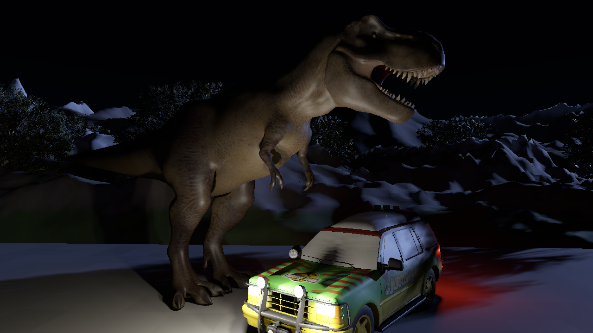
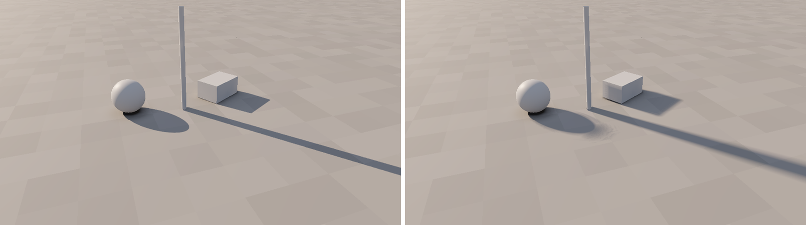
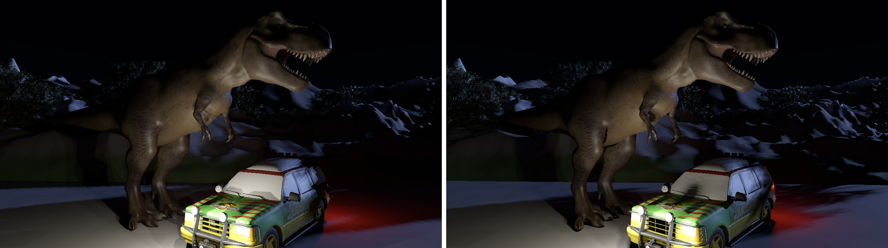

# FkJensen: film-style rendering on CPUs alone

Simon Legrand, 25/10/2026

## Summary

FkJensen is a 3D viewport and editor that makes every frame on the
processor's cores. It links no GPU API, uses no shader language and draws
no triangle through a graphics driver; the frame is pixels in memory,
copied to a window or written straight to the Linux framebuffer. The same
source builds for a Raspberry Pi 1 (one ARMv6 core at 700 MHz, no SIMD) and
for an x86-64 workstation with AVX-512, and the program measures the
machine it starts on to decide how much work a frame can hold.

It is built the way offline film renderers were before GPUs and ray
tracing took over: REYES micropolygons (Cook, Carpenter and Catmull,
1987), shaded in world space and kept between frames, so that a frame
costs what changed, not what is on screen. On top of that sit techniques
from the last twenty years of production and games, chosen because they
suit a CPU: Nanite's cluster hierarchy for level of detail (Karis,
Stubbs and Wihlidal, 2021), Ptex-style per-triangle textures (Burley and
Lacewell, 2008), precomputed radiance transfer for sky occlusion (Sloan,
Kautz and Snyder, 2002), point-based colour bleeding for bounce light
(Christensen, 2008), and per-object shadow fields for the shadows of every
light.

This paper describes how a frame is made, the shadow fields in most
detail since they are new here, and what each part costs, measured on 2
cores of an Intel Xeon at 2.1 GHz and an Intel i5-8250U laptop. It ends
with what is not done.

## Why the CPU

Graphics cards have become expensive enough that a machine without a
recent one is the normal case for many people who make pictures: an older
laptop, a small office machine, a single-board computer, a render node
bought for its cores. Every one of them has a CPU, several gigabytes of
memory and a large cache, and those are what FkJensen is designed for.

A CPU is good at things a GPU is not: deciding per item, following
pointers through irregular structures, holding large caches, and above
all remembering. A GPU pipeline redraws every frame from scratch because
that is what thousands of identical lanes do well. A CPU renderer can
instead keep what it worked out and redo only what a change touches. Most
of FkJensen's design follows from that: shading is kept per micropolygon,
light has a measured reach so that a change has bounds, and moving an
object relights only what its shadow and its reach cover.

Its rule is that nothing assumes a fast machine. Every cost is either
bounded by what is on screen, bounded by a light's reach, or held to a
memory budget that the program sets from what it measures.

## The machine decides

At start the program reads the CPU model, cores, clock, SIMD features,
cache sizes and memory (from `/proc` and `/sys` on Linux), then measures
two things in under a second: memory bandwidth on one core and on all,
and how many shading points a second the renderer's own shading code
manages on all cores. From those it sets:

- the window's micropolygon spacing, then its resolution, so a frame's
  shading fits a thirtieth of a second: micropolygons first move apart,
  from 2 to 8 pixels, and only then does the resolution drop, down to
  6.25% of the window;
- the size of a still (`--png`) for about 2 seconds of shading;
- whether the 10.8 M-triangle T-rex or its 28 K-triangle version is
  loaded, from memory available and the memory traffic of its triangles;
- the shadow map size, bounce light on or off, the gather budget per
  frame and the bucket size (half the L2 cache);
- the texture tile cache and the shading cache, an eighth and a quarter
  of what the scene leaves of available memory.

On the i5-8250U laptop (8 threads, 7.1 GB, 3.6 GB available) that gives
micropolygons 3.7 pixels apart in a 1280 x 720 window at 30 frames a
second, about 528 K shading points a frame. On a Raspberry Pi 1 Model B
(59 MB available, about 80 K shading points a second measured on
20/10/2026) the same rules give the low-resolution T-rex, no bounce
light, micropolygons 8 pixels apart and a frame of about 21 K pixels
scaled up to the screen. Those Pi figures come from the rules, which the
tests check; the program does not fit a 256 MB Pi 1 in memory yet.

The shading cache's budget is kept every frame: past it, clusters off
screen are dropped first, then micropolygons grow until what is on
screen fits. A small machine renders coarser or slower; it does not run
out of memory.

## Geometry

**Assets are baked for the renderer.** A model enters through an
importer (glTF, binary FBX, OBJ) that writes an `.fja` asset: geometry
already cut into clusters of up to 124 triangles and 64 vertices, small in space,
each with a bounding sphere and a normal cone; positions as 16 bits in
each cluster's box, normals as 16-bit octahedral pairs, colours as 8-bit
sRGB. Reading an asset is a copy, not a conversion. The high-resolution
T-rex takes 388 MB of geometry in memory this way against 1,162 MB as
32-bit floats, and the program peaks at 1.2 GB with it instead of 2.0 GB,
frame times unchanged.

**Level of detail** follows Nanite: neighbouring clusters are gathered in
fours and simplified to half by quadric edge collapse (Garland and
Heckbert, 1997) with their outer edges locked, cut into clusters again,
and so on up, each cluster recording its error and that of what replaces
it. The renderer draws, for each stretch of surface, the coarsest level
whose error looks smaller than the micropolygon spacing, so geometry
follows the machine's plan just as shading does. Shadow maps and the
bounce light's surfels choose their own level the same way.

**Instances** share vertices, triangles, levels of detail, materials and
texture tiles; an instance holds only its clusters' headers and its
surface samples. The night scene's 25 trees are one asset.

**Objects move by their transform.** Vertices are never rewritten: an
object's transform and its clusters' bounds change, and vertices are read
through the transform. Scale may differ by axis; normals then take the
inverse transpose. Moving the high-resolution T-rex went from 880 to
980 ms (every vertex of every level rewritten) to 18 to 20 ms.

## Shading

**Dicing follows the screen, not the mesh.** Each visible triangle gets
its own grid laid along its longest edge as seen, points at most two
pixels apart (or the machine's spacing), placed on the triangle in world
space with perspective correction, up to 256 parts a side. A triangle
under two pixels shades its own vertices. Only triangles that own a pixel
after visibility are diced.

**Shading is kept.** Diffuse light at each grid point stays in memory
until a light, the sky or the exposure changes it; the highlight, which
depends on the eye, is redone when the camera moves. A grid is kept while
its points stay between a quarter of the rate and the rate apart on the
new view. The light changed last keeps a share of its own at every point,
so dragging it takes its old share out and puts the new one in: one light
evaluated a point instead of all of them. Dragging the key light over the
high-resolution T-rex went from 437 ms to 298 ms a frame on 2 cores.

**Adaptive shading** shades every other grid point first and the points
between only where the four corners of a cell differ visibly; the rest
are interpolated, their light from the corners times their own albedo,
so texture detail stays. About a third of the points are shaded.

**Eight lanes.** Shading, shadow lookups and traces, and the bounce
raster work on eight points at a time through a portable SIMD layer that
becomes AVX2 or AVX-512 on x86-64, NEON on 64-bit ARM, and plain arrays on
the Pi 1. Each machine builds for its own processor.

**Materials** are one physically based model everywhere: a GGX highlight
with height-correlated Smith visibility and Schlick's Fresnel, multiple
scattering compensation (Kulla and Conty), and diffuse what the highlight
leaves. White under an even sky returns what reaches it at any angle and
roughness and never more; a test holds it to that.

**Visibility** is a depth buffer of triangle ids in 64 x 64 buckets, one
bucket per thread, no atomics, with clusters culled by the view, their
normal cones and a two-pass occlusion test against the last frame's
owners. While the camera is still, visibility is kept, and only pixels of
clusters shaded again are resolved again.

## Light

**Physical units.** Point lights are in lumens, from 1 to 2,000,000 (an
18 kW HMI, the largest common film light); the sky in lux; directional
lights in lux up to 150,000; the sun from 0 to 1000, set with the sky and
the exposure by the time of day. There is no falloff radius: inverse
square alone.

**Reach.** A light has no radius, but it does have a distance beyond
which it can no longer be seen, fixed by physics and the exposure:

    reach = sqrt(candela / cut)

where `cut` is the illuminance below which a contribution is dropped:
1/64 of what the sky gives the darkest-facing surface, and at least half
an 8-bit step at black. At dusk (cut 0.094 lux) a 40,000 lm fill reaches
184 m and the brightest light allowed 1.3 km, so no light on the set can
ever reach mountains 4 km away, however strong it is made. Each cluster
carries a mask of the lights whose reach touches it; shading evaluates
only those, shadow maps hold only the geometry inside their light's
reach, and a changed light invalidates only what its old and new reach
cover. Rendering the whole set with and without reach differs by at most
one 8-bit step on any pixel; the tests check it.

## Shadows: shadow fields

The shadows of every light, the sun, the directional lights and the
point lights, come from fields baked once into each model's asset and
traced at shading time. They replaced shadow maps as the default on
25/10/2026; maps remain as an alternative.

### What is baked

Each model asset carries a grid round its geometry, in its own space, 128
cells along its longest side plus one cell of margin (`SHDF` section,
`docs/format.md`). Each cell holds up to two bytes:

- **Distance**: to the nearest opaque triangle, unsigned, in eighths of a
  cell, up to 31.9 cells.
- **Density**: for cut-out surfaces (leaves on cards), the optical depth
  across the cell, from the solid area of the cut-out triangles in it,
  taken as thin plates turned every way, each blocking half its area on
  average: `tau = area / (2 h^2)` for a cell of size `h`.

A triangle is cut-out when under 90% of its alpha points are solid; the
rest are opaque. The bake uses the level of detail whose error is under a
quarter of a cell, bins triangles into blocks of 4 x 4 x 4 cells (only
the blocks they pass through), finds each cell's nearest triangle by
searching rings of blocks outward from the nearest block that holds one
(found first by a chessboard distance transform over the blocks), and
splats leaf density from the alpha tiles' points. On 2 cores: the car
(16,247 triangles) 3 s, a tree with leaf cards (12,745 opaque and 9,532
cut-out triangles) 10 s; on the laptop the high-resolution T-rex 53 s.
The car's field is 0.4 MB, the tree's 3.6 MB.

When an asset is read, an empty-space map (cells to the nearest cell
holding anything, by chamfer distance) is made from the two grids, and
all three are laid out in bricks of 4 x 4 x 4 cells, 64 bytes, one cache
line each.

### How a ray is traced

A shading point's visibility of a light is the product, over the objects
its way to the light can meet, of what each object's field lets through.
The objects are found per group of eight points: a sphere round the
eight, and every object whose bounding sphere, widened by the light's
penumbra, comes within reach of the segment from that sphere to the
light (or along the parallel direction, for the sun).

For each such object, the eight rays are taken into its own space through
the inverse of its transform, so a field is right wherever its object
stands, turned or scaled, and is shared by its instances. A scale that
differs by axis is handled by the shortest a unit length of the object's
space becomes in the world, so a distance read in the field stays a safe
step. A point on or by the object is first moved off its surface by a
cell and a half along its normal, as a shadow map's normal offset, so a
ray leaving at a grazing angle does not meet the surface it started on.
The ray then marches from where it enters the field's box (widened by the
penumbra) to where it leaves, or to a cell and a half short of the light,
so a lamp mounted against its car is not hidden by the surface it sits
on.

Each step reads the empty-space map at the nearest cell. Where everything
is at least a few cells away and out of the penumbra, the ray jumps that
far with no other look-up. Otherwise it reads the distance and density
trilinearly from the eight corners round it:

- distance `d` (in the world, less half a cell for the surface's
  thickness) sets the step, as in sphere tracing (Hart, 1996), and the
  penumbra: the light reaching the point is at most `d / (k t)` (Quilez's
  soft-shadow estimate), where `t` is how far the ray has gone and `k` the
  light's angular size, its radius over its distance for a point light,
  half its angle for the sun and a directional light. A shadow is sharp
  where its caster touches what it falls on and widens with distance from
  it;
- density adds `tau` times the step to the ray's optical depth, and the
  light let through is `exp(-depth)`, so a canopy dapples and thins at its
  edge.

Each light has a Shadow Falloff too: the distance over which a shadow
fades with its caster's distance, `exp(-t / falloff)`, for stylised
lighting; 0 turns it off.

Outside the grid but within its margin, the distance to the grid's box is
a lower bound on the distance to the geometry, and the distance read at
the nearest point in the grid, less that, is another: the ray takes the
larger of the two, so penumbrae continue past the box.

The eight rays step together: the per-lane work (positions, clamping,
trilinear weights, penumbra, steps, the end test) is eight wide, and only
the byte look-ups go lane by lane. Going from one ray at a time to this
halved the cost.

### Ingestion

Every model asset must carry its field. The importer bakes it as part of
import, with levels of detail, texture tiles, surface samples and sky
transfer; `fkj-import --fields` bakes it into existing assets in place.
An asset read without one is turned away with a message saying how to
build it; `--build-fields` bakes missing ones in memory instead, and the
editor offers to bake them into the asset files or for the session. An
object made in the editor gets its field when it is first saved. The
ground, the mountains and a scene's loose geometry are exempt: they cast
no field shadows (see below).

### Against shadow maps

Shadow maps are drawn per light: a cube of six maps for a point light,
three cascades for the sun and each directional light. They are kept
until their light moves, and redrawn in a rectangle round a moved object.
Fields are drawn for nobody: moving a light only shades again, and moving
an object only moves its field.

Measured on the night scene, 960 x 540, 2 cores of the Xeon (25/10/2026):

| | shadow fields | shadow maps |
|---|---|---|
| six car lamps only: shadows | none to draw | 0.63 s to draw |
| shading | 2.3 s | 0.74 s |
| rim light only: shadows | none to draw | 0.24 s to draw |
| shading | 1.0 s | 0.59 s |
| whole frame with bounce light | 25.6 s | 22.7 s |
| of which lighting the surfels | 4.9 s | 2.9 s |

Fields cost more today where many points trace through the object they
lie on towards a light close by: the car's surfaces towards its own
lamps, and the T-rex beside them. Such a ray starts near a surface,
where distances are small, so it takes short steps. For a distant light
(the rim light) the two are closer. The picture differs in kind: fields give contact hardening
and soft penumbrae sized by the light, maps a fixed 3 x 3 filter; under
fields the T-rex comes out brighter, the car's lamps sitting inside their
housings; and fields see no detail under a cell.

## Sky and bounce light

**Sky occlusion** is precomputed per model at import as nine numbers,
order-2 spherical harmonics, at surface samples spread 1 to 2 cm apart
over the model by dart throwing on its finest level. Each sample looks at
the rest of its model on a 6 x 8 x 8 cube raster of its neighbours'
discs, no rays, and what stays open, cosine weighted, is folded into the
nine numbers. A sky change is a dot product a sample; turning a model
turns its coefficients. Occlusion between objects, which move, is worked
out while shading from the other objects' sample discs facing the point
(Bunnell, 2005). Weta's PantaRay cached occlusion in a similar way for
Avatar.

**Bounce light** is point-based colour bleeding. The surfaces become a
cloud of lit discs (surfels) in a tree whose nodes carry summed area,
normal and radiance; receivers spread evenly over the surfaces walk the
tree nearest first, lay near discs one by one and far groups as one disc
onto a 6 x 8 x 8 cube raster, and fold it into spherical harmonics. A
pixel blends the receivers round it. A changed light relights only the
surfels in its reach and throws away only the receivers that change can
reach. One bounce.

## Textures

There are no UVs at render time. Each triangle carries its own tiles, as
Ptex does: a tile at level L holds the colour at the points of the
triangle cut into 2^L parts per edge, filtered once at import from the
source's mips. Shading reads a colour by interpolating between a tile's
points, with no filtering. Tiles stay in the file and are read per
cluster and level when seen, into a cache capped by the machine's plan.
A 1280 x 720 frame of the wide view read 4.1 MB of tiles; the textures
behind them are 71 MB decoded. Cut-out masks are tiles of their own
beside the colour, one byte a point.

## Scenes

A scene is a small JSON file (`.fjs`) that points at assets and holds
what belongs to the scene: transforms, groups, instances, frozen
transforms, lights and what they are parented to, the sun, sky, time of
day, cameras and render settings. Assets are written once; moving an
object changes a few kilobytes. The editor around the viewport is laid
out and named as Maya's (outliner, attribute editor, shelf, manipulators,
Freeze Transformations, Duplicate Instanced, Look Through), drawn with
egui and painted on the CPU into the same buffer as the frame.

## Not done yet

- Shadow fields: the ground, the mountains and a scene's loose geometry
  have none, so they cast no shadow; a terrain field is the next step.
  Detail under a cell (3.9 cm on the car, 9.9 cm on the T-rex) casts
  nothing of its own; a field holds one level of detail. Shadows of
  points tracing through their own object to a close light cost more
  than a shadow map; there is no visual debug view for fields yet; light
  linking (a lamp ignoring its own housing) is not there.
- A Raspberry Pi 1 has not run the current program: it does not fit 256
  MB yet, and the figures above are the plan's rules, not a measurement.
- Reflections (environment maps and per-object cube maps) are not
  started; nor are points, curves and volumes in the asset format, or
  splatting meshes with more vertices than pixels.
- One bounce of light only; surfels still follow the mesh.
- Base colour textures only; no roughness or normal maps.
- The editor has no undo.

## References

- Burley, B. and Lacewell, D. 2008. Ptex: per-face texture mapping for production rendering. Eurographics Symposium on Rendering.
- Bunnell, M. 2005. Dynamic ambient occlusion and indirect lighting. GPU Gems 2, chapter 14.
- Christensen, P. 2008. Point-based approximate color bleeding. Pixar Technical Memo 08-01.
- Cook, R., Carpenter, L. and Catmull, E. 1987. The Reyes image rendering architecture. SIGGRAPH.
- Garland, M. and Heckbert, P. 1997. Surface simplification using quadric error metrics. SIGGRAPH.
- Hart, J. 1996. Sphere tracing: a geometric method for the antialiased ray tracing of implicit surfaces. The Visual Computer 12(10).
- Karis, B., Stubbs, R. and Wihlidal, G. 2021. Nanite: a deep dive. SIGGRAPH Advances in Real-Time Rendering.
- Kulla, C. and Conty, A. 2017. Revisiting physically based shading at Imageworks. SIGGRAPH Physically Based Shading course.
- Quilez, I. Soft shadows in raymarched SDFs. iquilezles.org.
- Ramamoorthi, R. and Hanrahan, P. 2001. An efficient representation for irradiance environment maps. SIGGRAPH.
- Reeves, W., Salesin, D. and Cook, R. 1987. Rendering antialiased shadows with depth maps. SIGGRAPH.
- Sloan, P.-P., Kautz, J. and Snyder, J. 2002. Precomputed radiance transfer for real-time rendering in dynamic, low-frequency lighting environments. SIGGRAPH.
- Williams, L. 1978. Casting curved shadows on curved surfaces. SIGGRAPH.
- Wright, D. 2015. Dynamic occlusion with signed distance fields. SIGGRAPH Advances in Real-Time Rendering.
- Zhou, K., Hu, Y., Lin, S., Guo, B. and Shum, H.-Y. 2005. Precomputed shadow fields for dynamic scenes. SIGGRAPH.
